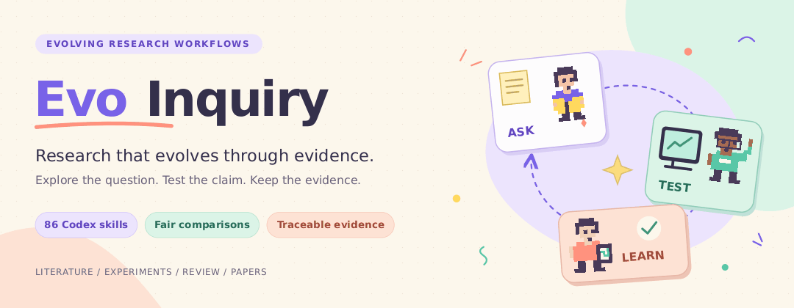
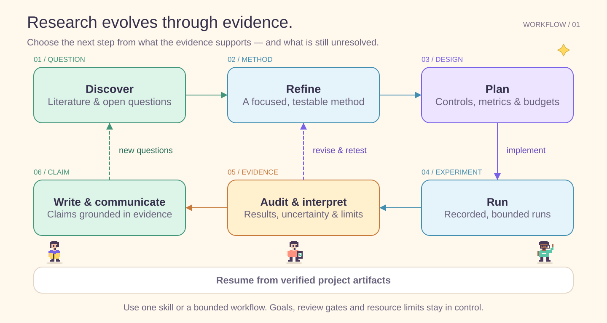
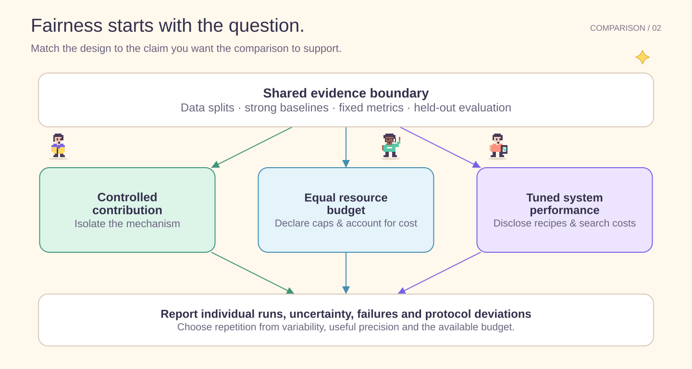
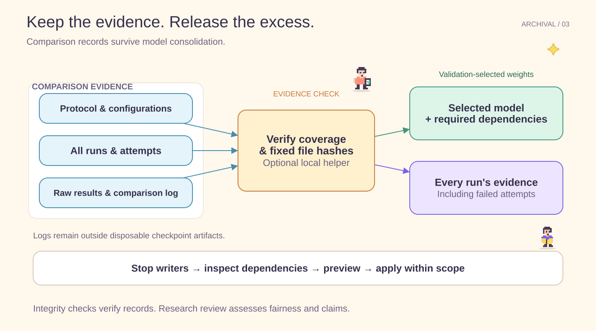

# EvoInquiry

<picture>
  <source media="(prefers-reduced-motion: reduce)" srcset="docs/assets/evo-inquiry-hero.svg">
  
</picture>

[静态封面](docs/assets/evo-inquiry-hero.svg)

<p align="center">
  <a href="https://github.com/Soceremite/EvoInquiry/releases/tag/v1.6.1"></a>
  <a href="RELEASE_NOTES.md"></a>
  <a href="docs/SKILLS_CATALOG.md"></a>
  <a href="https://github.com/Soceremite/EvoInquiry/actions/workflows/test-suite.yml"></a>
  <a href="LICENSE"></a>
</p>

<p align="center">
  <strong>让科研在证据中持续进化。</strong><br>
  <a href="README.md">English</a> · <a href="#installation">快速开始</a> · <a href="#capabilities">技能清单</a> · <a href="https://github.com/Soceremite/EvoInquiry/releases">版本下载</a> · <a href="CONTRIBUTING_CN.md">参与贡献</a>
</p>

朋友们，给大家介绍一个我们认真打磨的开源项目：**EvoInquiry，一个陪你把研究想法往前推进的科研搭档。**

做科研，大家都有体会。刚开始，方向可能只有一句话；读了很多论文，下一步怎么做，还是不清楚。
等实验跑起来了，又要管资源、看结果、找原因，最后还要把这些工作写成一篇有说服力的论文。
这里面的每一步，都需要下功夫。

所以，我们把 **89 个 Codex skill** 组织成一套科研工作流。从头脑风暴、文献检索，到实验设计、
运行监控，再到结果分析和论文写作，让前一步留下的证据，能够接得上后一步的工作。
既可以按需完成一个具体任务，也可以组成更长的科研流程。下一步由研究问题、已有证据与项目约束共同决定。

我们也花了很多心思打磨细节。做对比实验，数据、训练预算、随机种子，要交代清楚；
分析结果，除了看指标，还要主动看看具体样例，研究哪些地方做得好，哪些地方出了问题；
训练跑得久了，权重怎么保存、断点怎么恢复、存储怎么控制，也要提前考虑。

**我们最看重的，还是客观。** 有提升，就把提升讲清楚；有退步，也把退步摆出来；
证据还不够，就继续验证。科研工具要帮助我们把问题看得更清楚。

**EvoInquiry 1.6.1，继续开源。** 欢迎大家用自己的研究任务试一试，把真实的问题和建议带给我们。
我们一起，把这个科研搭档做得更扎实、更好用。

**开发中 — [1.6.2 更新](RELEASE_NOTES.md)：** 每个 session 一份资源表，首次选择，
后续所有科研 skill 复用；安排实验和启动前检查最新 GPU、内存与存储状态。
最大可用配置下，单任务 12 小时内无需重复审批预算。资源等待保持任务待处理，
不消耗训练重试。见[资源表说明](docs/SESSION_RESOURCE_BUDGET_CN.md)和
[验证范围](docs/VALIDATION_1_6_2.md)；当前正式下载版本仍为 1.6.1。

## 从模糊方向走向有证据的下一步

用 `scientific-brainstorming` 探索竞争解释和可检验的问题；当多个未解决问题可能
有共同原因时，用 `problem-synthesis` 做层级反思；再用 `research-manager`
在已有项目记录中跟踪决策、未解决问题与交接。文献记录保留身份、版本和阅读层级；图件记录关联
真实输入、可编辑源文件与图注。已有公平比较、权重保留和审阅门槛继续使用。
具体能力见[版本说明](RELEASE_NOTES.md)，实际验证范围见
[1.6.2 验证记录](docs/VALIDATION_1_6_2.md)。

可以直接说：“探索低成本记忆的研究问题，先不训练”“检查这些均值能支持
什么结论”“把CSV画成图，保留脚本、失败运行和误差定义”。明确需要时再运行
完整科研流程。

## EvoInquiry 的特色

| 设计重点 | 如何帮助科研 |
| --- | --- |
| **用证据决定下一步** | 从核验后的产物接续课题，定位未解决的问题，随着结果出现修正方法。 |
| **围绕研究问题设计比较** | 区分机制贡献、相同资源预算和充分调优性能，交代种子、失败与不确定性。 |
| **让结论连接原始结果** | 审查实验完整性，检验替代解释，核对论文主张与原始证据。 |
| **让长实验服从资源约束** | 预算保存峰值，限制恢复点数量，保护后续需要的模型依赖和完整实验记录。 |

## 能根据证据调整方向的科研流程



`research-pipeline` 衔接完整生命周期。明确的任务直接进入执行 skill；阶段不明确时，
`research-guide` 协调课题接续。方案、原始结果与评审报告作为后续工作的输入。
任务范围、评审门槛、资源预算和停止条件始终约束执行。

<a id="installation"></a>

## 快速开始

从 [正式版 Release](https://github.com/Soceremite/EvoInquiry/releases/tag/v1.6.1)
下载并解压 `evo-inquiry-1.6.1.tar.gz` 或 `.zip`。
下载包将在对应版本的发布门禁通过后提供。
请使用提供 `codex plugin` 命令的 Codex 版本；插件安装已在 Linux 上使用
Codex CLI **0.163.0** 验证。

```sh
cd /path/to/evo-inquiry-1.6.1
codex plugin marketplace add "$PWD"
codex plugin add evo-inquiry@evo-inquiry
```

安装后启动**新的 Codex 会话**，提供项目材料，直接描述任务：

> 将这个研究设想细化为具体、可实现的方法，结合项目中的相关工作，
> 明确最接近的已有方法和未解决的问题。

> 为这个方法设计公平对比实验：数据划分、强基线、训练与调参预算、
> 种子策略、评测设置和失败记录。

> 使用 `evo-inquiry:analyze-results` 汇总这些 CSV 中各个种子的结果，
> 保存比较表，完成分析后停止。

skill 使用 `evo-inquiry:` 命名空间。安装插件使技能可用；
常驻的选择偏好需要[另外配置](#usage)。

<details>
<summary><strong>源码开发与干净安装</strong></summary>

需要查看和开发源码时，可以使用
`git clone --branch v1.6.1 https://github.com/Soceremite/EvoInquiry.git EvoInquiry`。
安装插件时使用干净的 Release 解压目录。Codex CLI 0.162.1 也会复制来源目录中的
未跟踪文件；Release 包可以避免把私有验证记录、构建产物和 Git 历史带入安装缓存。

</details>

## 公平比较从研究问题开始



先确定比较回答什么问题。公共数据和评测设置只声明一次，再解释有理由的方法差异。
使用相关的强基线、验证集选择规则和独立的留出评测。

重复次数由实际波动、有用的估计精度和预算决定。除了汇总统计与不确定性，
也报告逐次结果、失败和协议偏离。实验设计决定结果能够支持机制贡献、
资源约束下的性能，还是充分调优后的系统表现。

规划 → 实现 → 执行 → 分析 → 审查共用同一份
[公平比较规范](skills/shared-references/comparative-experiments.md)。

## 保留证据，控制存储



长时间实验纳入存储预算，采用有界的断点保留。默认保留**最近两个有效恢复点**、
按验证指标选出的最佳模型，以及需要交付的最终模型。计划考虑并发保存峰值；
实现与监控检查实际保存行为和恢复能力。

训练完成或用户明确结束后，验证推理权重，再释放不再需要的恢复状态。
完成的对比实验优先保留按验证指标选出的最优模型，同时保护计划中的模型依赖，
以及**每组实验的证据，包括失败尝试**。

可选的本地工具在对比权重归档前检查声明记录的覆盖范围与固定文件哈希。
比较是否公平、结论是否受到支持，由科研审查判断。
参见[存储策略](skills/skills-codex/shared-references/experiment-storage.md)
和[对比证据格式](docs/COMPARISON_EVIDENCE.md)。

<a id="capabilities"></a>

## 按任务选择技能

| 能力 | 适用任务 | 代表 skill |
| --- | --- | --- |
| 课题接续 | 复用已有证据，协调下一项授权工作 | `research-guide` |
| 科研决策与交接 | 跟踪证据、备选方案、阻碍和已授权的下一步 | `research-manager` |
| 项目与证据治理 | 固定输入与执行身份，恢复报告，规划迁移 | `project-governance` |
| 环境维护 | 验证候选环境，保护论文复现所需的环境 | `environment-maintenance` |
| 文献与知识积累 | 检索论文，梳理已有工作，检查新颖性，维护知识库 | `research-lit`、`novelty-check`、`research-wiki` |
| 选题与研究设计 | 界定模糊方向，探索替代解释，打磨方法并规划验证 | `scientific-brainstorming`、`idea-discovery`、`research-refine`、`experiment-plan` |
| 理论推导与证明 | 整理假设，推导公式，撰写并检查证明 | `formula-derivation`、`proof-writer`、`proof-checker` |
| 实验与结果分析 | 实施比较，运行实验，分析种子结果，设计消融 | `experiment-bridge`、`run-experiment`、`analyze-results` |
| 证据审查与评审 | 审查完整性，判断结论支持程度，核对引用，检验替代解释 | `experiment-audit`、`result-to-claim`、`research-review` |
| 论文与图表 | 规划大纲，撰写 LaTeX，制作图表，编译论文 | `paper-plan`、`paper-writing`、`paper-figure` |
| 展示与投稿 | 制作报告和海报，回应评审，准备改投 | `paper-talk`、`paper-poster-html`、`rebuttal` |
| 项目申请与专利 | 组织基金申请，起草专利申请材料 | `grant-proposal`、`patent-pipeline` |

主要面向 ML、AI 与相关工程科研。
领域专用流程、总流程和可选后端见[完整 skill 清单](docs/SKILLS_CATALOG.md)。

1.4.0 将[案例分析](skills/skills-codex/shared-references/case-study-analysis.md)
纳入完整结果分析：主动检查已有逐样本输出，说明具体改善、退化和失败，保留可追溯、
公平配对的案例。分类看错分，回归看残差，生成任务看真实输出，视频理解看带时间位置的
证据。简短指标问题保持简短；没有样本输出时说明缺口，不编造案例。
新增推理或实验仍需相应的任务范围与资源授权。

<a id="usage"></a>

## 在项目中持续使用

1.5.0 增加有界持续推进：保留原始任务时钟，派发前预留资源，核对中断任务，
按当前来源检查交接。复用有效的已审工作，依据证据决定下一波；有依据的负结果与停止
同样可以完成研究任务。Plan／Goal 的分工、预算与恢复方式见
[使用说明](docs/BOUNDED_RESEARCH_CN.md)和[验证记录](docs/VALIDATION_1_5_0.md)。
Plan 和 Goal 是可选宿主功能，不会因安装 EvoInquiry 自动创建目标或后台服务。

> 继续这个课题，利用已有方案和初步结果，完成当前最有用的分析，
> 再准备受控比较计划；到计划完成为止，暂不启动新实验。

局部修改和只要求建议的任务保持原来的范围。可以显式指定任何 skill。
需要端到端流程时，使用 `evo-inquiry:research-pipeline`，并说明研究方向、
已有工作、目标产物和可用资源。

<details>
<summary><strong>让每次科研请求优先采用 EvoInquiry</strong></summary>

如果希望每次科研请求都优先采用 EvoInquiry，需要加入常驻的路由规则。
[AGENTS.md 片段](templates/EVOINQUIRY_AGENTS_SNIPPET.md)涵盖明确任务的直接调用、
短句追问、任务切换，以及在建议和实际执行中应用科研原则。已读取且未变化的规范
可以复用；后续对话继续使用 skill，不要求每次重新读取全文。

在源码目录中，用以下命令为一个科研项目配置规则：

```sh
python tools/configure_research_guidance.py --project /path/to/project --dry-run
python tools/configure_research_guidance.py --project /path/to/project
```

将 `--project /path/to/project` 换为 `--global`，可以让不同项目都采用这一科研偏好。
工具会保留其他指令；已有生效的 AGENTS.override.md 时更新该文件，并提供
`--check` 检查与 `--remove` 移除。修改后启动新的 Codex 会话。
安装插件使技能可用，不会自动安装这些常驻偏好。自动选择仍取决于模型判断，
用户明确指定的任务与 skill 优先。

</details>

<details>
<summary><strong>流程检查点与会话恢复</strong></summary>

可以通过流程检查点设置选择监督方式。`AUTO_PROCEED=true` 时，报告选定路径后
在同一轮继续执行已获授权的工作；显式阻塞的检查点需要用户回复。
`AUTO_PROCEED=false` 启用等待反馈的检查点。整个过程中均遵循项目说明与资源限制。
详见[工作流控制](docs/CUSTOMIZATION_CN.md)与[会话恢复](docs/SESSION_RECOVERY_GUIDE_CN.md)。

</details>

<a id="setup"></a>

## 环境配置与验证状态

检索服务、外部评审、GPU 平台、图像渲染器和 LaTeX 工具需要各自的依赖，
部分服务还需要凭据。请按实际需要配置，参见
[后端配置与兼容说明](compatibility/codex-backends.md)。

本项目提供的 EvoInquiry 安装方式是上面的 Codex 插件。
保留的后端与客户端兼容资源用于支持已有流程约定，按需启用并单独配置。

当前检查及其适用范围见[1.6.2 验证记录](docs/VALIDATION_1_6_2.md)。
最新引导通过 95 项本地专项检查，此前完整回归有 1,410 项通过。原生 Plan/Goal
实测验证资源选择、只读监听与 Goal 自动续跑，两轮均正常完成；监听对象是约
4 分钟的 CPU 任务。小时级 Goal/Plan 科研和 1.6.2 原生 Windows/macOS 验收仍未覆盖。此前的
[1.6.0 验证](docs/VALIDATION_1_6_0.md)通过 1,349 项测试，真实一小时 CUDA 工程运行验证有界恢复存储和数值
故障处理，另一段有界模型实测观察到 REPLAN、STOP 实际停止训练和完整状态重放。
失败尝试及对照组退化均保留。构造场景与显式引导的结果不证明普遍优于旧版、默认
常驻 watchdog 或数小时、数天无人值守科研。[1.5.0 实践记录](docs/VALIDATION_1_5_0.md)
和[1.4.0 发布记录](docs/VALIDATION_1_4_0.md)单独保留。
历史记录见[治理验收](docs/UPGRADE_VALIDATION_CN.md)和[兼容性验收](docs/PORTABILITY_VALIDATION_CN.md)。
[离线行为评估](docs/SKILL_BEHAVIOR_EVAL.md)使用冻结案例和实际执行轨迹比较自然请求表现。
下载包需要 Linux、macOS 完整 CI，以及 `powershell.exe`、`pwsh` 两组 Windows 原生安装与治理验收全部通过后发布。
真实服务与完整科研项目尚未在所有环境和学科中逐一验证。

<a id="contributing"></a>

## 参与贡献

见[贡献说明](CONTRIBUTING_CN.md)。本地检查：

```sh
python -m pip install -r requirements-dev.txt
python tools/verify_evo_inquiry.py
python tools/check_skills_inventory.py
python -m pytest tests/ -q
```

<details>
<summary><strong>升级、切换来源与回滚</strong></summary>

请通过 EvoInquiry Release 更新。Codex 加载的是安装后的缓存副本，
修改源码后需要刷新插件并启动新会话。移动源码目录后，
请重新注册该目录的本地 marketplace。

切换版本或移动来源目录时，进入目标 Release 的干净解压目录，先替换已有 marketplace 来源，再重新安装：

```sh
codex plugin marketplace remove evo-inquiry
codex plugin marketplace add "$PWD"
codex plugin add evo-inquiry@evo-inquiry
```

然后启动新会话，保留当前使用的来源目录。保留旧版目录即可用相同步骤回滚；插件切换不会自动迁移科研项目。存储探测、持久项目部署、备份边界与已验证的版本切换见[部署指南](docs/DEPLOYMENT_GUIDE.md)。

</details>

README 流程图采用本地可编辑 SVG，封面另有轻量 GIF 小人动画。
参见[图片源文件](docs/assets/README.md)，可以使用 EvoInquiry 自己的
`figure-spec` 和 `pixel-art` 工作流重新生成图片。

<a id="license"></a>

## 许可证与致谢

采用 MIT 许可证，见 [LICENSE](LICENSE) 和 [NOTICE](NOTICE)。
EvoInquiry 使用了 [ARIS](https://github.com/wanshuiyin/Auto-claude-code-research-in-sleep)
提供的科研工作流工具。
