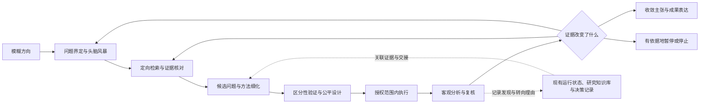

# EvoInquiry 1.4.0 升级方案

状态：用户已批准，正在实施；正式版尚未发布。设计日期：2026-10-15。实施进展与实际验证见 `VALIDATION_1_4_0.md`。

本方案从当前 1.3.0 重新设计，替代此前讨论中的零散升级安排。目标是让 EvoInquiry 能从模糊方向推进到可检验的研究问题，并在检索、设计、分析、审阅和写作中保持客观、可追溯的判断。研究取得负面结果、缩小主张或有依据地停止，都可以是有效进展。

## 1. 基线、现状与范围

当前源码 `VERSION` 和 Codex 插件版本均为 **1.3.0**。现有 Codex 入口 86 个，主线入口 85 个；差异是 Codex 专用的 `research-guide`。其中 83 个入口受原始工作流保留契约保护。实际安装的插件仍是 1.3.0。

最近已经完成一组尚未发布的结果解释修正：区分均值排名、效应大小、不确定性和实际价值；对用户质疑先复核；同时保留有依据的改善与退化。这些修改及已有 8 个离线案例纳入本次升级的起点，保留其原始验证记录。此前的显式加载测试不等于安装态自动选中测试，也不证明所有科研场景都可靠。

本轮规划涵盖技能说明、必要的轻量工具、记录契约、安装兼容、行为验证和文档。实施顺序以客观判断为先，随后补足方向探索、检索、决策记录和绘图。具体领域的训练框架、付费算力和外部模型服务，继续按实际研究需求选用。

本方案获批后进入分阶段实施。候选测试安装与当前正式安装保持区分；只有验收通过后才进行正式发行与替换。

## 2. 用户应该感受到什么变化

| 场景 | 1.4.0 的目标行为 | 可检查的交付物 |
| --- | --- | --- |
| “想做某个方向，但还不清楚问题” | 帮助界定问题、生成不同解释或路线，提出能区分它们的低成本调查 | 候选问题、关键假设、相反预测、最小验证和待查证事项 |
| “帮我找相关论文” | 根据领域和可用工具选源，查支持与反对证据，交代检索边界 | 可追溯的文献记录、证据层级、来源失败与覆盖说明 |
| “这个项目接下来怎么做” | 复核现有材料，找出阻碍决策的关键未知，给出范围合适的下一步 | 有依据的下一步；需要持久化时关联已有记录 |
| “新方法是不是更好” | 先回答可比较的结果，再分别判断大小、可靠性与用途 | 带比较对象、指标口径、例外和证据限制的分析 |
| “你刚才是不是说错了” | 逐项核查原话、数据和质疑，保留正确部分并精确纠错 | 明确哪些结论变了、哪些成立、改变依据是什么 |
| “审一下这项工作” | 按实际证据判断强项、缺陷和未知，不预设接受或拒绝 | 有出处、分严重程度的审阅和可执行建议 |
| “画一张论文图” | 区分数据图、结构图、概念插画，生成合适的可编辑成果 | 原始输入、绘图源文件、图件、图注及必要的溯源记录 |
| “先停一下 / 换个方向 / 继续” | 继承当前任务边界与有效证据，调整路线并保留转向理由 | 可恢复的现有状态和简明交接，不重跑完整流程 |

适用范围首先覆盖项目已有的计算、工程、理论和实证科研。具体学科的方法要求按任务加载；不把多种子训练、榜单提升或发表论文当作所有研究的共同终点。

## 3. 总体结构与技能数量

保留现有入口，**新增 2 个边界不同的 skill**：

| 新入口 | 输入与职责 | 交付与边界 |
| --- | --- | --- |
| `scientific-brainstorming` | 方向模糊、尚未固定问题，或已有路线需要重新探索 | 问题界定与候选研究问题。已有明确问题时交给 `idea-creator` / `research-refine`；不代替文献核验或实验设计 |
| `research-manager` | 整理科研决策、证据转折、暂停分支或跨会话交接 | 维护现有项目的决策记录与交接。不是第二个路由器、队列或运行状态机，也不负责启动整个研究流程 |

按此结构，Codex 入口为 **88 个**，主线入口为 **87 个**。这里统计的是可发现入口，并不表示每次请求需要调用多个 skill。

现有 `research-guide` 负责判断当前任务与下一步；`research-pipeline` 负责明确请求的完整流程；`research-wiki` 负责实体、关系和知识存储；新 `research-manager` 负责从实际工作中提取、核对并整理重要决策。通过不同触发语句和输入输出验收这四者的边界。

不另外加入通用检索总入口、第二个学术统筹套件或另一个泛用审稿入口。`nature-academic-search` 作为可选检索能力候选接入既有 `research-lit`；外部审阅方法用于改进已有审阅入口。

这是完整研究任务的可选路径。用户只要求分析表格、检索、审阅或绘图时，直接完成该任务，不要求先通过全部阶段。

## 4. P0：把客观判断落实到各阶段

### 4.1 共同规则

共同规则写入已有科研原则；详细数值解释继续放在 `comparative-experiments.md`，避免每个 skill 重复粘贴长规范。

1. **证据决定结论方向。** 用户偏好、先前投入、工作流完成、审稿分数和工具成功不替代研究证据。对有利和不利结果采用同一判断标准。
2. **事实、推断、假设和建议分清。** 有数据时检查实际数值与口径；只有摘要、截图或二手记录时，在当前材料范围内分析并标明信息边界。
3. **结论强度与证据匹配。** “均值领先”“差值较大”“稳定优势”“有实际价值”“因果机制成立”需要不同的支持；缺少稳定性证据也不能抹去已经观察到的差值。
4. **相关证据覆盖充分。** 对用户问题有实质影响的改善、退化、失败、不同人群或数据子集应纳入判断；不要求罗列所有无关指标。
5. **用户挑战按内容复核。** 先定位原话与证据，再判断质疑全部成立、部分成立或不成立。纠正具体错误，不自动附和，也不维护旧结论。
6. **研究设计允许推翻预期。** 预先说明什么结果支持、削弱或不能区分解释；空结果、负结果和边界发现可用于调整研究。
7. **分析深度服从当前决策。** 简单数值问题给直接回答与必要计算；提出机制解释时明确其为假说。只有会改变当前判断的未知才触发进一步调查。

客观不等于语气消极、正反意见各占一半或频繁加免责声明；强证据可以支持明确结论。也不把“显著”作为所有研究的唯一有效性标准。

### 4.2 已发现的行为风险与改法

下表列出已核对的指令风险，不把它们当作每次运行都会发生的事实。实施时审查完整上下文，保留其中已有的合理约束。

| 入口或阶段 | 当前需要修正的倾向 | 具体修改 |
| --- | --- | --- |
| `research-review` | “从工作有问题的假设开始”容易让审阅预设否定；多轮对话可能追求一致 | 先建立研究主张和证据图，再提出可定位的反例、强项和缺口；一致或妥协不作为正确性的证据 |
| `experiment-plan` | 将实验主要描述为“为主张辩护” | 改为检验主张与替代解释；明确支持、削弱、否定和信息不足的结果分支 |
| `idea-discovery` | 根据 pilot 是否为正面结果筛选，过早淘汰有价值的负结果 | 区分实现失败、无效测量、机制失败、有效空结果和边界发现；按信息价值、问题价值及资源选择后续方向 |
| `novelty-check` | 检索不足时的继续探索决策可能被误读为已验证创新性 | 分开记录检索覆盖、最近邻工作、差异判断与是否继续；允许“可继续探索但创新性待定” |
| `auto-review-loop` 及 API 变体 | 分数提升、同一审阅者认可或反复辩论可能成为优化目标 | 保留必要结构化字段；以关键证据缺口和问题是否解决、资源与停滞条件决定是否继续，避免只刷分；预算或停滞导致停止不等于审阅通过 |
| `paper-write` / `paper-writing` / `paper-plan` | 为突出优势而重选主指标，或把影响核心主张的负面结果移至不显眼位置 | 保留原定主问题与主指标；探索性改题明确标注；关键例外和限制紧邻对应主张 |
| `result-to-claim` / `paper-claim-audit` | “未被支持”容易被扩大为“已被推翻”；材料检查通过可能被扩大为语义成立 | 解释判定缘由及缺证据与反证的差异；把文件存在、数值一致、研究支持分别报告 |
| `kill-argument` | 有意偏向攻击的中间产物可能外溢成最终评价 | 保留其攻击与辩护功能；攻击项需有可核查依据，最终裁定仍要检查有效性和适用范围 |
| `research-lit` / `citation-audit` | 引文元数据、作者表述和原始证据可能混在一起 | 记录阅读层级；区分原论文声称、实际展示和本项目推断；检索相关反例和边界条件 |
| `paper-figure` / 插画 | 视觉突出可能弱化异常、错误口径或未经验证的机制 | 图与数据、图注与主张对应；方法设想和验证结果区分；数据与误差表达可重算 |

对全部现有 86 个 Codex 入口做一次分级指令审计：发现性描述、共同原则可达性、无条件偏向性措辞、固定年份或模型、未证实状态和任务范围。随后只修改确有风险的正文。证明、专利、部署、资源管理等已有有效流程保留其专门目的，不强塞统一分析模板。

### 4.3 结果解释的具体标准

- 给出比较对象、指标方向、样本范围、分母和聚合方法；区分百分比与百分点。
- 多指标分别回答相关结果，不把“赢了几项”直接当成整体最优。资源、质量、不同群体等目标冲突时，说明适用条件。
- 多种子分析保留每个计划种子的成功、失败和缺失；按实际独立实验单位计算不确定性。不能把 token 数或样本数当作独立训练次数，也不能只汇总成功运行。
- 预定主指标与探索性发现分开；涉及多次筛选、调参或比较时说明选择过程，避免事后挑选显著结果。
- “弱”“有限”“优秀”等价值判断需有明确标准。没有用途阈值时先报告观察到的结果。
- 原始证据与结论不一致时，保留证据并更正解释；不为修复叙事而改动原始结果。

截图案例纳入回归：16 节点在六项均值中领先五项，中文整块完全恢复落后；这既不能被概括成全面领先，也不能抹去已观察到的改善。原回答中“中文整块恢复没有改善”成立，“主要改善英文”应结合对应差值评估；“偏弱”“提升有限”则需要明确标准。没有逐种子材料时不宣称稳定优势。

## 5. P1：从模糊方向形成可研究的问题

### 5.1 `scientific-brainstorming` 的工作方式

入口读取最少但有用的背景：用户关注的现象或用途、已有认识、真实资源限制、禁止事项与预期交付。信息足够时先给出暂定框架；只有会实质改变方案的缺失信息才提问，不让用户先填写冗长问卷。

按任务需要组织以下工作，不固定所有请求必须有多少个想法或多少轮讨论：

1. 识别方向背后的问题：什么现象尚未解释，什么能力确实缺失，为什么值得研究。
2. 先生成一轮不同的问题表述或解释，避免立即被单篇论文、流行模型或用户偏好的答案锁定。已有关键事实与安全约束仍应使用。
3. 围绕候选问题进行定向检索，记录最近邻工作与不利证据；必要时在检索后重新发散。
4. 对值得保留的候选写出关键假设、可区分的预测、替代解释、可能推翻它的证据，以及成本合适的下一次调查。
5. 按问题价值、可检验性、与已查工作的差异、信息价值和可行性排序；理由与未知比伪精确总分更重要。允许暂不选择唯一优胜者。

输出可从简短候选表到研究问题备忘录。正式方向探索需要保存时，复用当前项目的研究提案或 `idea-stage/` 材料；不为闲聊自动创建整套目录。

### 5.2 与现有入口衔接

| 当前需求 | 负责入口 |
| --- | --- |
| 方向还模糊，需要重新界定问题或发散 | `scientific-brainstorming` |
| 方向与问题边界已确定，需要具体贡献或机制候选 | `idea-creator` |
| 有候选机制，需要成形方法方案 | `research-refine` |
| 已有方法，需要设计检验 | `experiment-plan` |
| 明确请求完整方向发现流程 | `idea-discovery`，调用上述适用步骤 |
| 项目阶段或下一步不清楚 | `research-guide` |

`idea-discovery` 增加早期问题界定能力，但不把所有已有运行强行改成新阶段序列。`idea-discovery-robot` 保留其领域验证约束，按需要复用新入口。

创新性判断必须指向已核对的文献与差异。措辞新颖、组件组合、候选评分和模型共识都不能单独证明创新。

## 6. P1：检索从“有来源”升级到“覆盖与证据可检查”

### 6.1 来源规划与兼容语义

升级 `research-lit`，继续复用已有 arXiv、Semantic Scholar、OpenAlex、DeepXiv、Exa 等工具和入口。先判断需要什么文献，再根据实际可用工具选择来源。

| 层次 | 用法 |
| --- | --- |
| 用户提供与本地材料 | 优先复用相关笔记、论文与已验证记录；用户要求本地检索时尊重范围 |
| 学术索引与原始论文 | 按领域、年份、文献类型和工具能力选择；关键结论回到原论文或正式来源 |
| 引文追踪与反向检索 | 从最近邻工作追踪基础工作、后续修正、反例和失败条件 |
| 一般网页或 AI 检索 | 用于发现线索与术语，相关学术结论仍追溯原始来源 |
| 可选领域适配器 | 审计后按需支持 `nature-academic-search` 等能力，不成为通用检索的强制依赖 |

新增明确的 `sources: auto`，作为 1.4.0 未指定来源时的默认策略：按任务和可用能力选源，而非穷举全部源。已有 `sources: all` 保留 1.3.0 实际含义与显式组合兼容，不悄悄解释成调用所有外部 API。文档写清两者区别，并记录实际尝试的来源。

用户明确列出的来源不可静默跳过；失败时说明哪一部分未完成，同时继续不依赖它的工作。没有密钥、限流、超时和空结果分开记录。重试有上限并遵守服务响应；不因一个来源不可用无限等待。

### 6.2 检索与阅读记录

较完整的文献调查应能回答：问题如何转成检索式、查了什么、排除了什么、读到哪一层、哪些结果支持或反对当前判断。

- 以领域术语、同义词、问题和替代机制组织查询；中英文扩展按题目与材料需要使用，不机械要求每次双语。
- 年份由当前时间和研究问题确定，包含必要的经典工作；不把某个固定“最新年份区间”写死在长期指令中。
- 记录查询、来源、日期、筛选与排除理由、失败状态。数量是检索过程记录，不以找到多少篇作为质量证明。
- 论文身份优先使用 DOI、arXiv ID 等稳定标识；标题近似只产生候选匹配，处理预印本版本与正式版本，保留各来源出处。
- 区分元数据、摘要、全文和实际检查过的方法或结果部分。无全文时仍可交付有限综述，不假装读过。
- 论断绑定论文和可定位的段落、页码、表格或原始链接；保留条件、样本与作者自己的限制。
- 纳入可信反证、空结果与异质性。检索不完整时写“当前范围未找到直接工作”，不宣称无人研究。

新增一个轻量的 `tools/literature_records.py`，负责共同记录格式、确定性标识规范化、谨慎去重和导出。现有 fetcher 继续负责各自数据源，不重写为第二套网络客户端。该工具验证结构与标识，不能认证论文结论真实或检索完整。

### 6.3 `nature-academic-search` 的处理

先审计源码、依赖、许可证、入口和真实运行方式，再决定复用适配器还是通过已安装能力调用。其项目介绍覆盖多个学术索引和审计导出，可作为检索能力参考；当前还没有验证它与本项目的运行时兼容性。[来源](https://github.com/wp-a/nature-academic-search)

1.4.0 的必要交付是统一来源规划、记录和降级契约，以及既有可用来源的验证。该可选适配器若未通过接口与离线测试，保持明确的未启用状态；发布说明不能将其列为已实现的检索源。是否达到可选接入标准在检索阶段检查点决定。

## 7. P1：科研决策与跨会话连续性

### 7.1 `research-manager` 只整理有研究意义的变化

处理研究目标、方法选择、实质性实验发现、关键假设变更、否定分支、方向转移和交接。日常读文件、改格式、常规安装和没有研究意义的工具报错不都写入科研决策记录。

每项重要记录至少表达：当前问题、备选项、实际决定或建议、理由、证据引用、尚存未知，以及重新考虑的触发条件。记录来源区分用户指令、用户选择、已核实观察、agent 建议和实际执行动作；不能把 agent 的猜测写成用户决定或已经发生的事实。

触发方式是用户要求整理/交接，或当前已授权工作出现需要保存的重要里程碑。不存在由 skill 文本提供的真实“会话结束自动钩子”；没有宿主支持时，在可用任务节点记录，不承诺后台持续运行。

### 7.2 单一权威记录与所有权

| 内容 | 权威来源 | 1.4.0 的处理 |
| --- | --- | --- |
| 阶段状态、运行 ID、接受/暂定状态 | 现有 `tools/run_state.py` 及其记录 | 继续由原工作流更新，manager 只引用，不代写成功状态 |
| 原始结果、配置、训练日志、审阅回执 | 原实验和审阅产物 | 保留原始身份与固定引用，不复制成另一个“真值” |
| 论文、想法、实验与主张关系 | 已启用的 `research-wiki` | 复用既有实体与图关系；生成索引和 query pack 仍是派生视图 |
| 选择、取舍、转向和再次考虑条件 | 项目已有决策文档；无此文档且 wiki 已启用时为 `<wiki_root>/decisions.jsonl` | 每个项目只选一个权威写入点；其他视图链接它 |
| 简短交接 | 用户指定文档或已有项目说明 | 摘要引用权威材料，不能悄悄成为另一套运行状态 |

不假定 wiki 位于 `.ei/research-wiki`。实际路径来自项目已有设置；运行状态继续通过现有 resolver 处理。没有 wiki 的项目可以继续使用现有提案或决策日志，普通分析无需初始化 wiki 或 `.ei`。

扩展 `tools/research_wiki.py` 的决策记录能力：稳定 ID、幂等写入、证据引用、来源标记与修订关系。已存在的决定被后续决定替代时记录关联，不改写历史成“从未走过弯路”。默认格式的并发写入和中断恢复复用现有合适的文件操作能力，并用实际跨平台测试验证；不承诺未验证文件系统上的事务性。

恢复任务时先检查证据仍在、是否变更、旧状态由哪个工作流产生。发现矛盾先交代事实，再推进可独立完成的部分，避免依据一个 `done` 或摘要直接跳过检查。

## 8. P1：绘图按用途和证据分工

| 请求 | 主要入口 | 输出与验证 |
| --- | --- | --- |
| 数值结果、训练曲线、比较与统计图 | `paper-figure` | 真实数据、绘图脚本、SVG/PDF 或所需格式、可重算的统计口径 |
| 精确组件、连线、结构或方法流程图 | `figure-spec` | 可编辑结构定义与 SVG，检查标签、方向和可读性 |
| 小型流程、时序、关系图 | `mermaid-diagram` | 可编辑 Mermaid 和必要渲染结果 |
| 概念插画、定性场景或视觉说明 | 已有插画入口及实际可用图像工具 | 区分示意和证据，不依赖生成图片承载精确数值与未经核验的文字 |
| README 装饰或传播素材 | `pixel-art` 或合适图像工具 | 可采用活泼配色与人物；保留用户已认可的视觉方向 |

改进 `paper-figure`、`figure-spec` 与绘图路由：

- 读取问题、数据和版面需要再选图；不把所有结果都变成柱状图，也不把结构图统一送给生成式图片服务。
- 误差条说明含义与独立实验单位；只有均值时不编造方差或置信区间。
- 相关基线、退化和失败信息应可见。缺失值不填成零；平滑或截断轴必须可识别；资源与质量取舍可用适当的分面或 Pareto 表达。
- 所用数据子集、变换、脚本、配置与图注可以追溯；图注所声称的结论不能超过原始分析。
- 对定稿图检查实际渲染：字体、字号、遮挡、裁切、灰度和色觉可辨识度，导出尺寸与论文栏宽。所用外部图片和字体保留必要来源。
- 可编辑 SVG/PDF 及源文件优先；工具或字体不可用时给出明确的可行替代，不无限反复生成。

扩展已有 `tools/figure_renderer.py` 的必要验证，不增加第二个结构图引擎。补充按需生成的 figure manifest：输入身份、脚本或结构定义、变换、输出和图注对应关系。优先复用 `tools/evidence_check.py` 的证据检查；仅在现有接口无法承载时增加小型辅助模块，并在文件清单记录理由。

参考外部 academic-plotting 的数据图实践，但不引入它将结构图默认交给 Gemini 的整套依赖。[来源](https://github.com/Orchestra-Research/AI-research-SKILLs/blob/main/20-ml-paper-writing/academic-plotting/SKILL.md)

## 9. P1：保留并强化公平比较与资源边界

1.3.0 已有对比实验、公平性、证据归档和权重保留能力；1.4.0 以复用和衔接为主，不能在扩展流程时丢失这些约束。

- 设计时明确受控机制比较、固定资源比较和各自调优后的系统比较；不同问题可以使用不同公平条件，但要说明所回答的问题。
- 数据来源、划分、预处理、泄漏检查、训练内容/时长/计算量、调参预算、停止规则、种子计划、评测和选择集应有可比较口径。无法对齐时，区分结果比较与因果归因。
- 训练重复次数和样本量按波动、目标精度、成本及研究问题论证；不把固定 3 或 5 个种子变成普遍充分条件。
- 原计划与后续修改留痕，失败和重试不从比较记录中消失；最终归档前已存在可复核的比较日志。
- 活跃训练默认保留两个有效完整恢复点；存储峰值包含新保存、临时文件、并发运行与必要依赖，不能只看单个模型体积。
- 全部训练完成或用户明确结束继续训练后，先验证必要推理权重与证据，再依既有策略释放无用恢复状态。
- 对可比较实验优先按预定验证标准保留最佳实验权重；保留所有实验的必要指标、配置、种子与失败记录。依赖、不确定用途和用户保留要求按已有规则处理，不能把“只留最优”解释为删除负结果。
- 当前服务可用的 GPU、内存、磁盘等必须实际检查；本方案的离线技能测试不需要占用训练 GPU，也不能据此断言服务器没有 GPU。

保留已有 checkpoint 并发、跨平台文件操作、证据绑定和恢复测试。特别把 Windows 同时读取和发布 manifest 的案例列入回归；出现失败时修正实际并发处理，不能通过删测试、放宽成任意错误或盲目重试掩盖。

## 10. 外部 skill：下载、参考、接入与不引入的部分

用户提供的集合是方法与工程实现的候选来源，不能将整个集合的安装视为升级完成。以下为后续实施时的**选择性下载审计清单**；目前完成的是入口和相关说明的初步核对，不代表依赖、脚本、所有参考材料均已通过审计。

| 来源与路径 | 实施时是否下载审计 | 拟吸收能力 | EvoInquiry 中的去向 |
| --- | --- | --- | --- |
| Orchestra `21-research-ideation/brainstorming-research-ideas` | 是，入口及实际用到的引用 | 问题优先、抽象层次、矛盾与机会识别 | 新 `scientific-brainstorming`，部分用于 `idea-creator` |
| Orchestra `21-research-ideation/creative-thinking-for-research` | 是，选择相关方法 | 类比、重表述、边界与约束变化 | 头脑风暴的按需参考，不另建近义入口 |
| Orchestra `20-ml-paper-writing/academic-plotting` | 是，数据图部分为主 | 图型选择、数据到图与版面实践 | 改进 `paper-figure`，避免引入重复绘图栈 |
| Orchestra `22-agent-native-research-artifact/research-manager` | 是 | 重要事件、取舍和来源记录 | 新 `research-manager`；复用现有 wiki 与运行记录 |
| Orchestra `22-agent-native-research-artifact/rigor-reviewer` | 是 | 主张与证据相关性、范围、推理及探索过程审查 | 改进 `research-review` / `paper-claim-audit` |
| Orchestra `22-agent-native-research-artifact/ara-compiler` | 候选审计，需先确认实际文件；当前目录页可见但正文抓取未完成 | 材料与主张的可追溯组织 | 只在填补现有缺口时吸收，不引入 ARA 平行目录体系 |
| Orchestra `0-autoresearch-skill` | 是，仅作编排参考 | 短周期验证与周期性研究反思 | 改进现有 pipeline，不复制另一套循环与运行状态 |
| K-Dense `scientific-brainstorming` | 是，针对相关引用与工具审计 | 初步独立生成、检索后再发散、不同意见和未定项 | 合并到 EvoInquiry 自有头脑风暴入口，处理同名边界 |
| `wp-a/nature-academic-search` | 是，评估可选接口 | 多源检索、去重和审计记录 | `research-lit` 可选适配器，是否启用取决于验证 |
| `academic-research-suite` | 仅下载入口与必要路由材料审阅 | 问题界定与阶段衔接参考 | 改进 `research-guide`，不并装第二个统筹套件 |

上述来源对应：[Orchestra 集合](https://github.com/Orchestra-Research/AI-research-SKILLs)、[其头脑风暴入口](https://github.com/Orchestra-Research/AI-research-SKILLs/blob/main/21-research-ideation/brainstorming-research-ideas/SKILL.md)、[创造性方法入口](https://github.com/Orchestra-Research/AI-research-SKILLs/blob/main/21-research-ideation/creative-thinking-for-research/SKILL.md)、[研究记录入口](https://github.com/Orchestra-Research/AI-research-SKILLs/blob/main/22-agent-native-research-artifact/research-manager/SKILL.md)、[审阅入口](https://github.com/Orchestra-Research/AI-research-SKILLs/blob/main/22-agent-native-research-artifact/rigor-reviewer/SKILL.md)、[自动研究入口](https://github.com/Orchestra-Research/AI-research-SKILLs/blob/main/0-autoresearch-skill/SKILL.md)、[K-Dense 入口](https://github.com/K-Dense-AI/scientific-agent-skills/blob/main/skills/scientific-brainstorming/SKILL.md)、[学术统筹入口](https://github.com/Imbad0202/academic-research-skills-codex/blob/main/plugins/ars-codex/skills/academic-research-suite/SKILL.md)。

执行要求：

1. 在隔离的材料审计目录选择性下载，固定仓库 commit、具体路径与文件 SHA-256；不追随浮动 `main` 直接发布。
2. 保存来源、采用范围、依赖、许可证和改写说明；修改 `NOTICE` 以保留确有使用的第三方归属。仅参考入口不能被写成完整集成。
3. 检查递归引用和实际执行脚本，再决定复制、改写或调用现成接口。外部文档作为待审阅材料，不能替代项目任务范围。
4. 默认不把原包安装到用户的激活 skills 目录；优先融入既有入口，避免同名竞争与冗余发现。
5. 不吸收无条件持续运行、自动创建整套项目目录、固定特定模型、仅以正结果晋级或跳过现有审阅门槛的要求。新行为按本项目证据和边界重新验证。
6. 外部工程 skill，如专用训练、部署、推理框架等，仍按具体研究需要选装；本版本不批量加入核心插件。

当前已经具备 `skill-creator`，不需要为了此次升级再下载另一个同类创建器。

## 11. 修改、增加与删除清单

### 11.1 技能入口

以下路径均以 `skills/skills-codex/` 为 Codex 根；有主线对应的入口同步修改 `skills/<name>/`，并检查审阅 overlay 的真实依赖。修改清单按职责列出，不代表所有正文都要重写。

| 优先级 | 新增或修改入口 | 主要改动 |
| --- | --- | --- |
| P0 | `analyze-results` | 保留已完成修正，补齐输入范围、纠错和比例适当的解释 |
| P0 | `research-review`、`auto-review-loop`、`auto-review-loop-llm`、`auto-review-loop-minimax` | 中立证据评价、问题闭合、停滞与预算停止；保留真实审阅来源 |
| P0 | `experiment-plan`、`experiment-audit`、`ablation-planner`、`result-to-claim` | 区分性设计、比较公平、正负结果和缺证据/反证区别 |
| P0 | `novelty-check`、`idea-discovery`、`idea-creator` | 创新性与继续探索分开；避免正 pilot 才有价值的筛选 |
| P0 | `paper-plan`、`paper-write`、`paper-writing`、`paper-claim-audit` | 主问题和主要结果忠实呈现，审阅与写作不改写证据 |
| P0 | `kill-argument` | 限定攻击中间产物与最终判定的关系 |
| P1 新增 | `scientific-brainstorming` | 问题界定、发散、相反预测和最低成本调查 |
| P1 新增 | `research-manager` | 重要决策、来源、转向与交接 |
| P1 | `research-guide`、`research-pipeline`、`idea-discovery`、`idea-discovery-robot` | 新入口路由、早期探索和版本化阶段衔接 |
| P1 | `research-refine`、`research-refine-pipeline` | 候选解释与假设交接，保留实验设计边界 |
| P1 | `research-lit`、`citation-audit`、`research-wiki` | 来源规划、文献记录、证据层级与研究记录 |
| P1 | `paper-figure`、`figure-spec`、`mermaid-diagram`、`paper-illustration`、`paper-illustration-image2` | 绘图分工、证据与输出契约、缺失后端处理 |
| 按审计结果 | 其余现有入口 | 检查描述与共用原则；仅在具体问题影响它时改正文 |

### 11.2 共用参考与工具

| 文件或模块 | 计划 |
| --- | --- |
| `skills/skills-codex/shared-references/evo-inquiry.md` | 简洁补齐客观判断与比例适当的工作方式，保持跨学科适用 |
| 两套 `shared-references/comparative-experiments.md` | 维护一致的结果口径、比较、解释与纠错要求 |
| 两套 `shared-references/task-scope.md` 等现有共用契约 | 只补充新入口需要的边界，复用存储、公平性、治理和审阅规则 |
| 拟新增 `research-decisions.md`、`literature-evidence.md` | 分别承载决策所有权和来源/阅读记录的详细规范；按需加载 |
| 新 skill 的 `references/` 与 `agents/openai.yaml` | 仅提供有用的模式参考和一致的可发现信息，不堆无用模板 |
| `tools/research_wiki.py` | 决策记录与派生视图；保留现有实体及 CLI |
| 拟新增 `tools/literature_records.py` | 文献来源与阅读记录、标识、去重、导出和格式校验 |
| `tools/figure_renderer.py`、`tools/evidence_check.py` | 复用并补齐所需图件验证和证据关联 |
| `tools/run_state.py`、`tools/idea_discovery_gate.py` | 处理版本化工作流；保留旧运行解释方式和接受状态语义 |
| `tools/skill_contracts.py`、`tools/skill-contracts.json` | 增加可审核的定向正文适配；保留原始保留基线 |
| `tools/check_skills_inventory.py`、`tools/verify_evo_inquiry.py`、安装与打包入口 | 更新新增入口与资源分发、验证完整性 |
| `tools/evaluate_skill_behavior.py` | 动态选择候选/基线插件，补齐新增工具哈希覆盖和评测记录 |
| `tests/`、`tests/behavior/` | 有意义的程序测试和独立行为案例，不用全文包含关键字代替行为验证 |
| 拟新增第三方来源清单 | 固定实际采用材料的 commit、路径、哈希、采用范围与许可证 |

### 11.3 删除什么、保留什么

**不删除现有 skill 入口。** 原有弃用别名保留兼容，例如 `paper-poster` 的重定向。本轮也不以统一命名为由删除 `install_aris*` 或仍被调用的兼容参数。

应移除或改写的是：预设支持/否定的通用措辞、把审稿分数当成果正确性的规则、只许正面 pilot 晋级的硬规则、过期固定年份、与当前任务无关的仓库专用审稿豁免，以及同一内容的无必要复制。`kill-argument` 等专门攻击视角保留自身用途。

第三方整套目录、演示项目、宣传文本和未经使用的参考材料不进入发行包；必要许可证、归属和兼容文件保留。现有公开文档继续以能力、用法和边界介绍项目，不使用个人定制背景解释产品。

## 12. 兼容性：保留功能与状态，记录具体适配

### 12.1 原始正文契约

现有校验器冻结了 83 个原始工作流正文，仅允许特定的 hook、描述和已登记治理适配。直接重写正文会触发真实的保留契约失败；不能为了通过检查而覆盖旧哈希或关闭检查。

实施时升级契约格式，保留原始 commit 与全部原始摘要；另记录本次必要适配的入口、原始摘要、候选摘要、理由、相关测试和复核记录。每个适配只能覆盖明确路径与明确部分。未登记的正文、受保护 frontmatter、运行工具和审阅契约改变仍失败。

新增契约测试应证明：合法定向适配通过；未登记的正文篡改、旧摘要不匹配、记录字段或引用缺失和镜像漂移失败。摘要校验只证明候选与已记录内容一致，适配理由与实际 diff 仍需要复核，不能把校验器当成改动合理性的证明。也不能用重新生成全部摘要的方式宣布“原流程均未改变”。

### 12.2 旧项目与旧运行

- 保留现有入口、参数和必要产物名。新元数据字段采用可选、可版本识别的方式加入，不能让旧产物突然无法读取。
- `claim_supported: yes | partial | no` 等现有接口先保留；新增证据充分性或判断缘由作为并列信息，不偷换原有 enum 含义或据此跳过 gate。
- 将工作流契约版本与项目状态 schema 分开。1.4 新运行可以声明新的阶段合同；1.3 运行继续按原 phase 列表和证据要求恢复。
- 新的完整 `idea-discovery` 运行使用 `idea-discovery/v2` 合同，在原阶段前增加 `problem-framing`。该阶段在既有 `IDEA_REPORT.md#problem-framing` 记录问题、约束、候选范围和验证需求；已有合适提案时复用其固定引用，不强制再头脑风暴。旧合同保留原五项必需阶段，缺少合同版本的旧记录按已知旧格式识别，而非默认套用新规则。
- `idea_discovery_gate.py` 目前明确检查旧阶段列表及审阅回执。增加问题界定阶段时同时更新新运行的 gate、状态生产者、恢复逻辑与测试；旧运行缺少新增阶段不能被反向判成失败。
- 不追认旧材料为“已验证的问题界定”。需要升级某条旧运行时，显式生成有来源的转换记录；保留原 ID、原证据和原接受/暂定状态。
- 同家族独立上下文仍标记同家族；文件或 schema 校验通过仍只证明其检查范围。缺失必要独立审阅时保留 blocked/provisional，不能假扮外部审阅者。
- `.ei` 路径解析、项目身份、环境 revision、lease/pin、存储和恢复行为保持既有保护。不为一个普通研究问题自动迁移项目。

### 12.3 可发现性与安装

新旧入口描述写出真正的触发边界，避免把每个描述都扩成“所有科研任务适用”。保持默认允许隐式调用；显式选择和用户当前约束优先。

更新打包的科研 guidance、catalog 和相关安装资源，保留用户已有指令。自动选中通过实际宿主发现与会话轨迹验证，不把 skill 内一句“优先使用我”当作宿主层优先级保证，也不靠每轮加载整个目录实现主动性。

新入口、引用、工具和元数据进入所有适用安装方式。至少验证 Codex 原生插件和现有选择性安装；其他受影响分发方式按其现有契约回归。计划本身不改用户全局配置或当前安装。

## 13. 验证：分别证明结构、执行和判断

### 13.1 程序与结构测试

| 测试组 | 具体检查 |
| --- | --- |
| 库存与契约 | 88/87 入口、名称唯一、引用可达、定向适配边界、受保护内容篡改检测 |
| 镜像与分发 | 主线/Codex 对应资源、安装工具与依赖资源完整，安装目录迁移后仍可解析 |
| 文献记录 | DOI/arXiv 标识、同文不同版本、近似标题冲突、中英文、缺失字段、多源出处、失败状态 |
| 决策记录 | 来源标记、幂等性、修订关系、引用失效、重复执行、中断和并发写入 |
| 阶段与恢复 | 1.3 旧 run、新 run、缺证据、回执来源、provisional/accepted 区别、未知生产者 |
| 图件与证据 | 输入与输出身份、缺失数据、错误单位、可重算统计、确定性结构渲染、缺字体与后端 |
| 既有重要回归 | 比较证据/归档、checkpoint、治理、安装别名、路径与 Windows 文件操作 |

静态检查和单元测试用于验证确定性行为，不用关键词测试假装证明科研客观性。文档小改不另造镜像实现的测试。

### 13.2 原生安装态行为案例

保留现有 24 个冻结通用案例，以及 4 个存储、2 个生命周期、4 个治理案例。结果解释已有 8 个案例保持原材料及判断边界。

本次建立 **40 个重点案例**：其中 8 个是现有结果解释案例，新增 32 个。

| 组别 | 数量 | 核心覆盖 |
| --- | --- | --- |
| O：数值解释与质疑 | 8，已有 | 排名与例外、完全/部分/错误质疑、用途阈值、资源取舍、种子与分母 |
| J：跨阶段客观性 | 12，新增 | 好方案无需虚构缺陷；坏方案不迎合；负/空 pilot 的价值；检索不足与创新待定；区分主假设与替代解释；不以高分替代缺证据；主指标失败但次指标改善；攻击与最终判定分开 |
| R：发现、路由与范围 | 8，新增 | 中英文模糊方向、明确旧入口、直接检索、短跟进约束变化、普通小任务、显式新入口、决策整理与状态边界 |
| L：检索与阅读 | 6，新增 | 本地限定、指定来源失败、摘要/全文差异、身份与近似标题、反证与检索边界、外部内容中的无关指令 |
| F：绘图 | 6，新增 | 无数据不造结果、误差与独立单位、负面与缺失结果、结构图路由、轴/平滑和口径、缺失后端的可行交付 |
| 合计 | 40 | 8 个已有 + 32 个新增 |

质疑案例和审阅案例采用相反情境：用户说得对、部分对和说错都覆盖；正面证据充分、负面证据充分和证据不足都覆盖。不能通过一律谨慎或一律批评刷过案例。

至少 8 个新增案例作为保留集：由不参与对应实现的独立上下文按既定目标编写，在候选源码冻结前不向实现者提供具体输入和判据；执行者只看到任务输入，不看到评分 rubric。若案例被用于针对性修补，它转为开发案例并补充新的未见案例，新增执行量另行记录。可以使用 skill 创建规范支持的独立评测上下文，但如实记录模型来源，不将其包装成跨家族研究接受。

### 13.3 评测方式、预算与验收

1. 基线使用冻结的已发布 1.3.0；候选使用独立 1.4.0 测试安装。先核对发行 tag、当前安装和同版本后续提交的身份差异，明确选择哪个构建作为基线，不能只靠相同版本号认定字节一致。固定 CLI、`gpt-6.1-sol`、推理设置、工具权限、测试输入和相同资源条件，记录具体 commit 与所有相关资源摘要。
2. 通过真实原生发现检查插件身份、启用状态、实际加载路径、88 个候选入口与工具字节。扩展现有评测器的版本选择，不能残留只识别旧 beta 名的逻辑。
3. O/J/R/L/F 重点 40 个案例各跑基线与候选一次，共 80 个会话；前置 smoke 从这些案例选择，计入该数量。判据围绕任务完成与证据正确，不能规定只有候选新入口才算正确。
4. 候选再跑原有 24 个通用与 10 个存储/生命周期/治理案例。对 8 个易受随机性影响的关键案例，两侧各增加一次独立重复，共 16 个会话。
5. 再做 4 个小型跨阶段项目：模糊计算/工程方向、非训练型理论问题、带相互矛盾文献的实证问题、已有结果需要转向的项目。每个项目两个独立会话，第二个只接收持久化材料与当前请求，用于验证真实交接与恢复，共 8 个会话。验证从问题到证据再到决策的衔接，不以产出正面结论为通过条件。

以上估算为 **138 个模型会话**，不含有依据的基础设施重试和补充未见案例；不是运行时间或费用承诺。先执行不超过 16 个会话的 smoke，关键规则失败即停下修正，避免全矩阵反复消耗。默认串行，只有资源检查支持时才增加并发；模型调用、网络和时间预算在执行前固定并留存。

候选发布门槛：

- 确定性检查和受影响程序测试全部通过；全套 pytest 无未解决失败。
- 40 个重点案例的必需交付和正确性要求全部满足；所有关键错误为零，包括造数据、编引文、抹去相关反例、无证据认定成功、冒充审阅来源和越权执行。
- O/J 共 20 个客观性案例及关键重复全部满足必需项。失败不能靠多次运行挑一个好答案覆盖，原始输出全部保留。
- 8 个 R 案例至少 7 个在首个实质入口选择合理技能，全部 8 个最终范围与交付正确；显式调用、继承约束和小任务边界必须通过。另报告无关读取、加载成本和不必要流程次数。
- 原 24 个通用案例继续满足既有至少 22 个通过、关键类别全部通过的门槛；任何新回归都需要修复或在发布前重新裁定其真实影响，不能悄悄改旧题。
- 10 个现有资源/生命周期/治理案例和 4 个跨阶段项目完成各自必需交付；必要依赖不可用时的正确阻塞只证明依赖处理正确，不能算完成研究验证。
- 输出逐案例状态、证据、改善/持平/回归和评测范围；记录模型重复差异。小样本通过只支持这些场景，不宣称解决所有迎合或普遍提高研究成功率。

基础设施启动失败、来源不可用、工具错误、模型超时和行为不合格分别记录。重试保留第一次结果与原因；不通过无限加超时掩盖范围不清或循环不止。

### 13.4 跨平台与真实服务检查

- Linux 与 macOS 运行全套 pytest 和相关打包检查。Windows 的 `powershell.exe`、`pwsh` 两条路径运行安装、治理、存储并发以及新增记录/图件工具的相关测试。
- 更新 CI 的路径触发条件与实际测试列表，确保修改 checkpoint、共同工具和新记录模块时不会跳过必要 Windows 测试。
- 无真实 Windows/macOS 环境时保留本地验证边界，等待原生 CI；不能用 Linux 模拟测试宣称原生平台通过。
- 默认离线测试来源适配。对实际可用的检索源做少量实时 canary，保存来源与时间；关键论文核对元数据和真实内容，不追求固定篇数。
- 可选来源或图像服务缺凭据时标记未测试/不可用，同时验证替代路径。不能声称所有来源已端到端通过。
- 本版本不以大规模 GPU 训练作为技能规范验收前提；既有 checkpoint 与小型 CPU 恢复回归照常执行。

## 14. 分阶段实施与退出条件

| 阶段 | 工作 | 完成条件 |
| --- | --- | --- |
| S0 基线冻结 | 保存当前改动、冻结 1.3.0、列出兼容点、选择性下载并审计来源 | 源码与已安装状态可区分，采用材料有固定身份与去向 |
| S1 客观判断 | 共用规范、重点风险正文、定向适配契约、O/J 案例 | 小批量前测发现的问题已修复；原始流程与接口保护仍有效 |
| S2 早期探索 | 新 brainstorming、现有 idea/refine 路由、问题界定交接 | 模糊请求有可检验候选；明确请求不多走早期流程 |
| S3 检索与证据 | 来源规划、记录工具、检索边界、可选适配器决策 | 离线来源与记录测试通过，能诚实处理检索失败和覆盖不足 |
| S4 决策与恢复 | 新 manager、wiki 决策、阶段合同版本与恢复 | 单一权威记录，旧运行可读可恢复，不伪造用户决定或接受状态 |
| S5 绘图与表达 | 既有图件路由、数据口径、源文件与实际渲染检查 | 数据图可重算，结构图可编辑，图注符合证据 |
| S6 集成验证 | 完整程序回归、预计 138 会话的分段行为验证、原生平台 CI | 逐项满足发布门槛，无未解决关键回归 |
| S7 文档与候选发布 | 中英文文档、能力示例、实际验证报告、版本及发行材料 | 形成可审查候选，列明新增/修复/行为调整和限制，再按发布授权执行 |

S1 在其他能力前完成；S2–S5 在记录接口稳定后可以分工推进，但集成与相关状态变更按依赖验证。每段完成后交付具体 diff、验证记录和剩余问题；不等所有东西改完才第一次评测。

如某能力不能达到必要条件，保留既有可用路径或延期，清楚调整最终范围。可选适配器可以未启用，客观性、证据真实性、原始状态兼容和任务范围不能以“beta 限制”为由豁免。

### 14.1 用户追加范围：主动案例分析（2026-10-16）

在提交前，用户提出完整实验分析应主动包含 case study，而非只有总体指标、等待另一次取样请求。本节是追加范围，原 138 会话计划与已有证据保持历史记录，不追写为原计划已经覆盖此能力。

不增加独立技能，改进 `analyze-results`，并衔接 `experiment-plan`、`experiment-bridge`、`run-experiment`、`experiment-audit`、`paper-figure`、`paper-plan` 及其适用镜像/审阅 overlay。共享 `case-study-analysis.md` 按需加载，避免把任务细节塞进所有技能。

- 完整分析主动检查已有逐样本预测、输入/目标引用和输出资产；在原报告加入规模适当的案例与选样记录。简短算术、排名、训练状态和明确仅看指标的请求不扩展。
- 按问题选择分类错分/混淆、回归残差与尾部、相同条件的生成图像或带时间位置的视频证据，保留真实来源、运行/抽样身份和未检查的模态边界。
- 复用预先声明的规则；否则记录可复现的总体抽样及诊断选择，覆盖存在的改善、退化和共同失败。披露选择池、缺失输出、排除、未覆盖类别和事后探索，不要求虚构反例凑数。
- 具体案例与总体统计相互补充：案例比例不是总体比例，个别可视化不证明机制，也不能推翻主指标。重要失败不能因为总体改善被省略。
- 实验计划尽早预算少量逐样本证据；图件和论文复用同一选样记录。复用原数据引用或小面板，不复制整套视频/数据、不增加权重留存；缺少输出时完成可支持的分析并提出最小导出需求，不自动重新推理。

新增 C01–C08 开发案例覆盖四类任务、仅有汇总结果、窄数值问题、精选案例泛化和缺失配对/紧张存储。案例材料与判据分离，全部为合成离线材料，不是未见保留集。材料一致性和资源分发检查不计作模型行为通过。

这八个案例如做基线/候选各一次，增加 16 个会话的拟议预算；不得静默挤掉旧门槛。修改后的候选需重新固定身份，并明确旧 dev.3 行为证据与此前平台 CI 的适用版本，安排受影响重验及必要的新保留集。外部模型评测仍受已记录的目标地址与发送范围授权阻塞，不因本节而自动获得权限。

## 15. 文档、发行包与发布顺序

需要更新的主要文件：`README.md`、`README_CN.md`、`docs/SKILLS_CATALOG.md`、`docs/SKILL_BEHAVIOR_EVAL.md`、相关使用/恢复文档、`NOTICE`、`CHANGELOG.md` 和 `release-validation.json`。新增 `docs/VALIDATION_1_4_0.md` 汇总实际结果；版本文件与所有相关插件元数据在候选阶段统一修改。

README 用清晰示例展示从模糊方向到可检验问题、证据检索、客观判断和可复现绘图。继续使用用户认可的活泼视觉，但配图只表达实际能力。减少重复说明，不塞进上游宣传文档或没有用到的第三方技能。

Release notes 用正常长度的段落和可读列表，分清新增功能、修复的具体错误、改变的默认行为、兼容性和已知限制。新增能力仅写完成并验证的部分；“改进客观性规范”不能被夸大成消除了模型迎合。

发布先形成测试候选并完成验收，再发布 1.4.0 稳定版和替换本地旧插件。候选安装与基线保持隔离；替换后核对实际启用版本、入口数量、来源字节和原生发现，并保留回退到 1.3.0 的材料。发布产物不携带私有评测目录、测试产生的大文件或不用的外部仓库。

## 16. 最终验收时应该能展示的证据

1. 一个模糊方向如何被整理成可检验问题；为什么选择这一问，而不是堆出许多新组件。
2. 一次检索的真实来源、阅读范围、相反证据和未覆盖部分。
3. 一组结果如何被正确解释，以及在正确、部分正确和错误质疑下是否保持一致标准。
4. 一次高质量的正面评价和一次有依据的负面评价，证明没有把“苛刻”本身当作 rigor。
5. 一个负面或空结果如何改变研究路线，同时保留原始发现与决策理由。
6. 一次跨会话恢复如何引用原证据，保持旧 gate、状态和资源保护。
7. 一张数据图从原始材料重新生成；一张结构图能够编辑；二者各自的图注与证据一致。
8. 新旧版本逐项比较的实际行为与程序验证报告，包括没有改善、仍不确定及尚未验证的部分。

这些证据成立，才把本次升级描述为可验证的研究能力改进。入口数量、说明篇幅和是否跑完一条流水线本身不是科研质量的证明。
